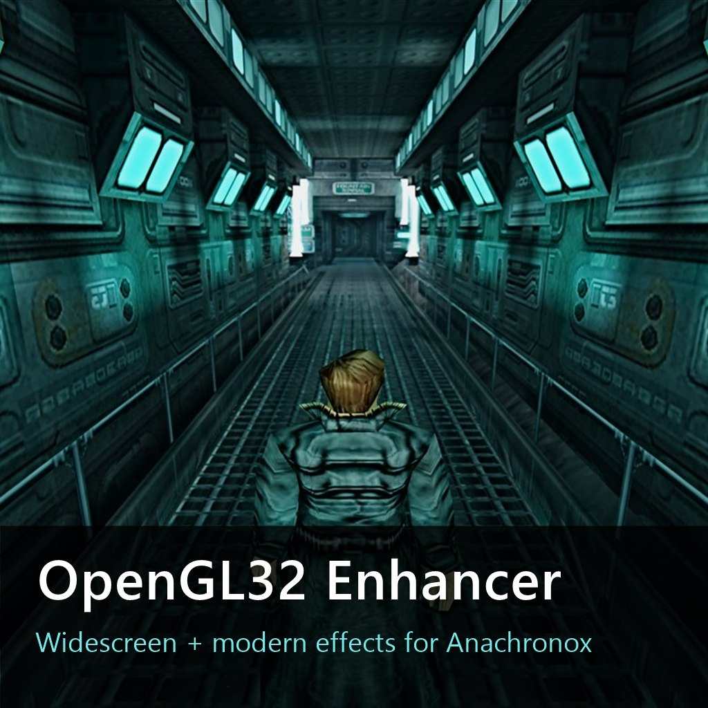
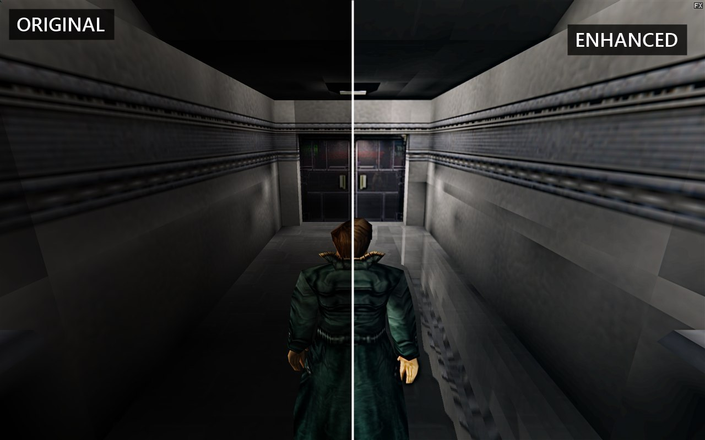
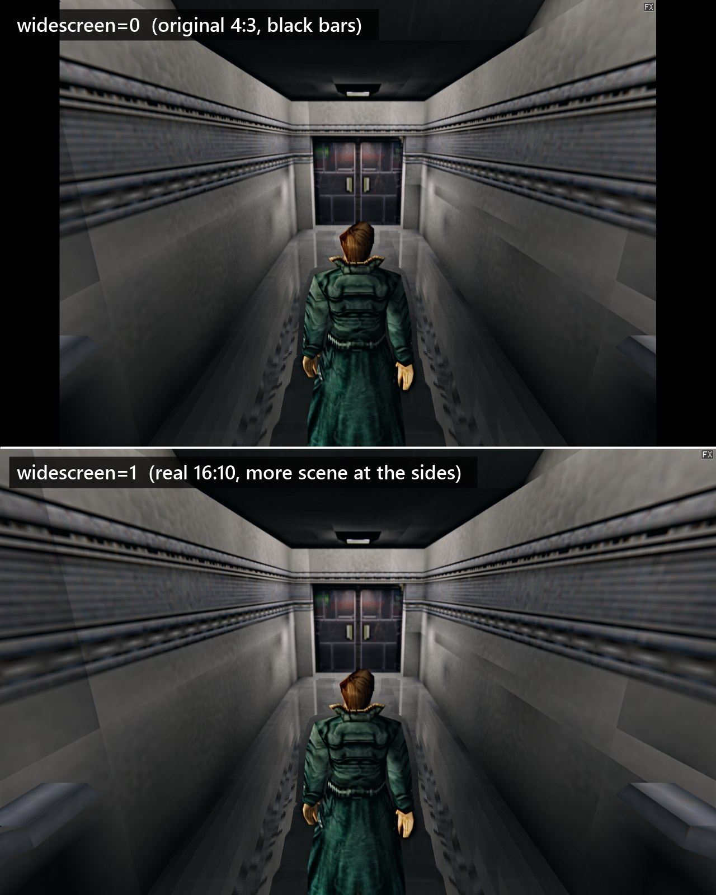

# Steam Community guide: OpenGL32 Enhancer for Anachronox

A ready-to-publish Steam guide that shows Anachronox players how to install,
use and tune `opengl32.dll`.

**Just want to read it?** Open [guide.md](guide.md).

- [guide.md](guide.md): the same guide in Markdown, for reading on GitHub.
  It is generated from `guide.bbcode` by [bbcode_to_md.py](bbcode_to_md.py), so edit the
  BBCode and run `python bbcode_to_md.py guide.bbcode guide.md` here rather
  than editing guide.md by hand.
- [guide.bbcode](guide.bbcode): the guide text, split into 11 sections and
  written in Steam's BBCode (`[h2]`, `[b]`, `[list]`, `[table]`, `[code]`...).
- [images/](images): the pictures. Each `{{IMAGE: name.jpg}}` marker in the
  guide says where one goes.

## Publishing it on Steam

1. Open the Anachronox Community Hub → **Guides** → **Create a Guide**.
2. Fill in the title, description and category from the header of
   `guide.bbcode`, and upload [images/cover.jpg](images/cover.jpg) as the
   preview image.
3. For each `=== SECTION n` block in `guide.bbcode`: **Add Section**, paste
   the title and the body.
4. Upload that section's pictures (listed below), put the cursor on each
   `{{IMAGE: ...}}` marker, delete it, and insert the matching upload. The
   editor writes its own `[previewimg]` tag, which is why the file has markers
   instead of tags.
5. Preview it, then **Publish**. Steam makes a published guide public right
   away, so check the preview first.

## Pictures by section

| Section | Picture | Shows |
| --- | --- | --- |
| Guide preview | `cover.jpg` (1024x1024) | Title card over an enhanced corridor |
| 1 Overview | `compare-bricksc.jpg` | Original / enhanced split |
| 2 Before and after | `compare-bricksc.jpg`, `compare-sunstrip.jpg`, `compare-museum.jpg`, `compare-hephtower2.jpg` | Original / enhanced splits on four maps |
| 4 Install | `install-files.jpg` | The four files next to `anox.exe` |
| 6 Widescreen | `widescreen-compare.jpg` | `widescreen=0` (4:3, black bars) above `widescreen=1` |
| 8 Settings editor | `config-editor.jpg` | `config_editor.exe` with the default pipeline |

Spare pictures, in case you want a different layout: the full-frame
`*-off.jpg` / `*-on.jpg` pairs behind each split, and
`widescreen0-bricksc.jpg` / `widescreen1-bricksc.jpg`.

## How the pictures were made

- **Before/after splits**: one frame dump per map (`frameDumpKey`, taken
  at 2560x1600 with widescreen on). Each dump went through
  `config_editor.exe --render` twice: once with the shipped
  `opengl32_enhancer.ini` and once with `effect=none`. Both halves come from
  the same input frame, so the only difference is the effects.
- **Widescreen**: real in-game screenshots taken with the DLL's
  `screenshotKey`, with `widescreen=0` and then `widescreen=1`.
- **Editor**: a screenshot of `config_editor.exe`, showing the built-in
  test scene.

The helper scripts (`guide_renders.ps1`, `guide_ws.ps1`, `guide_editor.ps1`,
`guide_compose.ps1`) are in the git-excluded `work/` folder. Run them again
after a visual change to the default settings.
