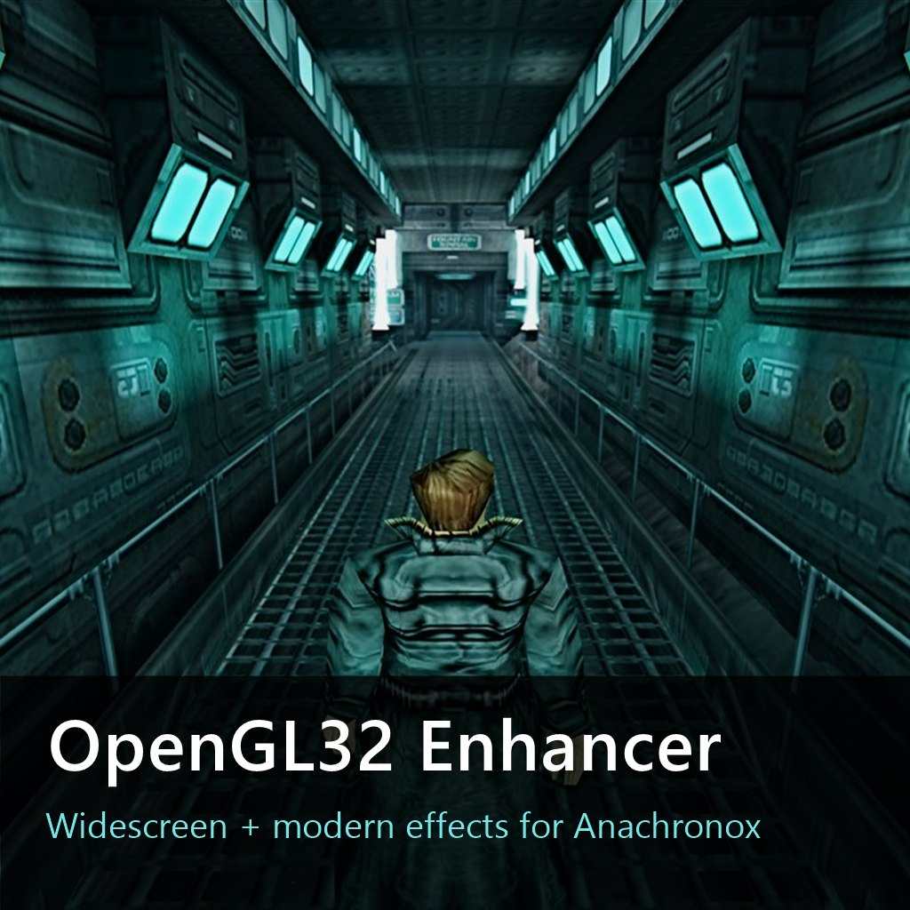
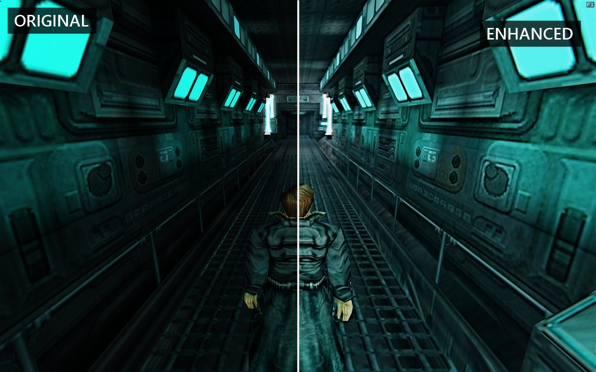
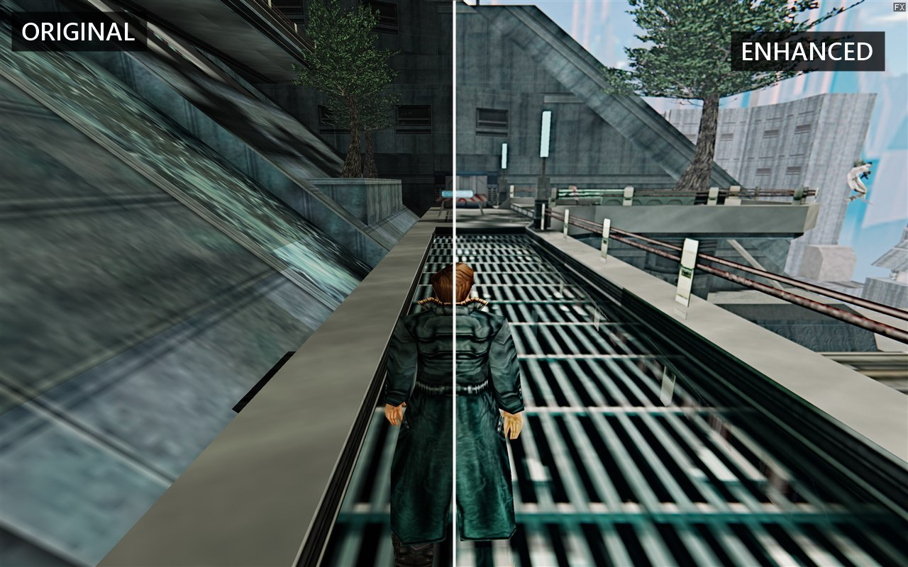
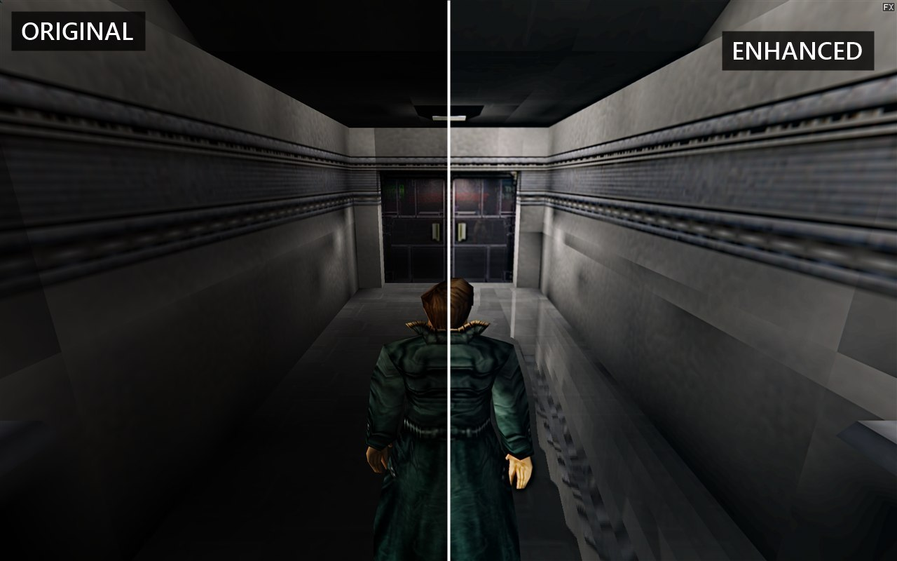
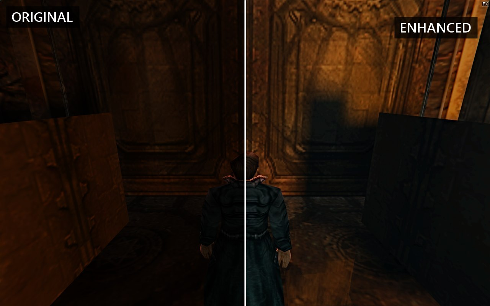
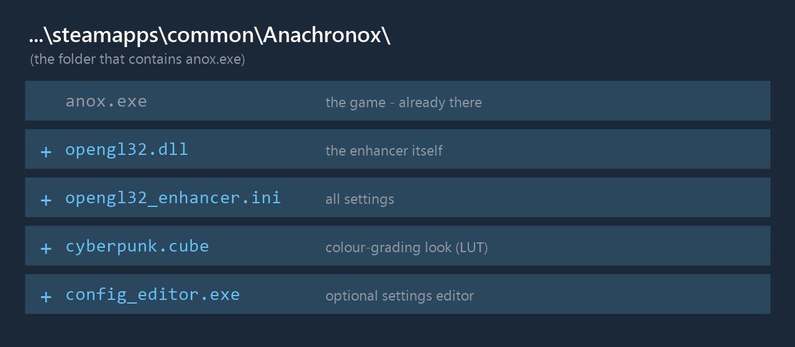
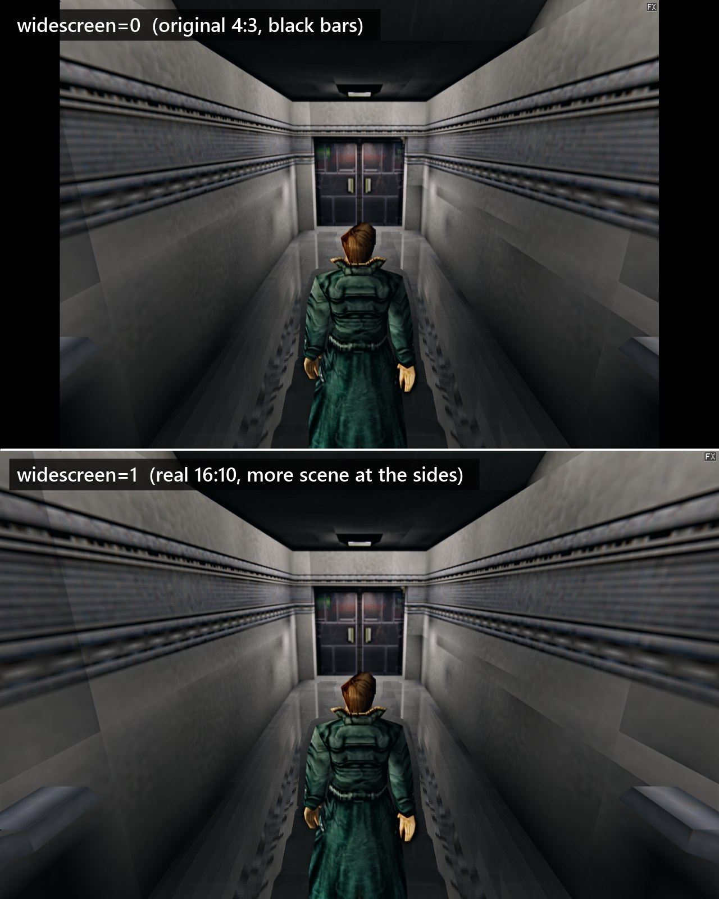
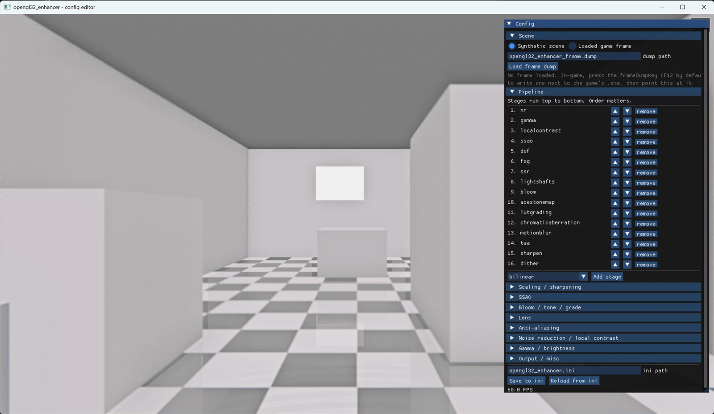

# OpenGL32 Enhancer: real widescreen and modern graphics for Anachronox



*Install one DLL and Anachronox fills a 16:9 / 16:10 screen properly, with SMAA/TAA, sharpening, bloom, ambient occlusion, reflections and colour grading. Step-by-step setup, tuning and troubleshooting.*

> This is the readable copy of the [Steam Community guide](https://steamcommunity.com/sharedfiles/filedetails/?id=3843494655).
> Its source is [guide.bbcode](guide.bbcode); [README.md](README.md) explains how to publish it.

## Contents

1. [Overview](#overview)
2. [Before and after](#before-and-after)
3. [Step 1: Download](#step-1-download)
4. [Step 2: Install](#step-2-install)
5. [Step 3: Launch the game](#step-3-launch-the-game)
6. [Widescreen and resolution](#widescreen-and-resolution)
7. [Tweaking the look](#tweaking-the-look)
8. [The settings editor (optional)](#the-settings-editor-optional)
9. [Screenshots and performance](#screenshots-and-performance)
10. [Troubleshooting](#troubleshooting)
11. [Credits and links](#credits-and-links)

## Overview

**OpenGL32 Enhancer** is a free, open-source add-on that drops into the Anachronox folder and makes the 2001 game look at home on a modern monitor. No patching, no launcher, no installer: Windows simply loads it in place of the system OpenGL library.



### What you get

- **Real widescreen.** The 3D view fills a 16:10 or 16:9 screen: you see more of the scene at the sides, nothing is stretched, and menus and the HUD keep their original shape in the centre.
- **Borderless fullscreen** at your desktop resolution, instead of the old blurry 4:3 display modes.
- **Supersampling**: the game renders at up to 2560x1600 (or more) and is downscaled, giving clean, crisp edges.
- **Post-processing** in the style of ReShade: anti-aliasing (SMAA/TAA), sharpening (CAS, FSR 1, NVIDIA sharpen), noise reduction, ambient occlusion, screen-space reflections, bloom, light shafts, fog, depth of field, ACES tone mapping and LUT colour grading.
- **Sharper textures** through anisotropic filtering.
- **A settings editor** with a live preview, so you can tune the look without restarting the game.

### Requirements

| What | Needed |
| --- | --- |
| OS | Windows 10 or 11 |
| Game | Anachronox (Steam or GOG), running its OpenGL renderer |
| Graphics card | Any GPU with OpenGL 4.3 support (practically anything from the last ten years) |
| Extras | Nothing to install. No Visual C++ runtime needed |

The project lives on GitHub: <https://github.com/ASDAlexander77/opengl32_enhancer>

## Before and after

Every picture below is the same frame twice: the left half is the original game, the right half is the enhancer's default settings.

### Neon corridor


Deeper contrast, brighter neon, sharper metal detail.

### Rooftop walkway



Clearer sky and haze, sharper grating, reflections on the walkway.

### Museum hallway



The original is very dark on modern screens. Gamma correction lifts it without washing out the blacks, and the polished floor now reflects the walls.

### Tower interior



*Tip: the small "FX" badge in the top-right corner shows the enhancer is running. You can turn it off once everything works (see "Tweaking the look").*

## Step 1: Download

1. Open the releases page: <https://github.com/ASDAlexander77/opengl32_enhancer/releases>
2. Under the newest release, click **opengl32_enhancer.zip** to download it.
3. Right-click the zip and choose **Extract All...**

Inside the zip you will find four files:

| File | What it is |
| --- | --- |
| **opengl32.dll** | The enhancer itself |
| **opengl32_enhancer.ini** | All settings, each one explained in comments |
| **cyberpunk.cube** | The default colour-grading look |
| **config_editor.exe** | Optional settings editor with a live preview |

## Step 2: Install

1. In Steam, right-click **Anachronox** in your Library, then choose **Manage > Browse local files**. This opens the game folder, the one that contains **anox.exe**.
2. Copy all four files from the zip into that folder.



**Important:**

- Put the files **next to anox.exe**. Do **not** copy them into C:\Windows\System32 or anywhere else.
- If Windows asks whether to replace an existing **opengl32.dll**, another OpenGL wrapper is already installed. Only one can work at a time, so remove the old one first (back it up if you want to keep it).

That's it. There is nothing to register or run.

### Uninstalling
Delete the four files from the game folder. The game is back to stock.

## Step 3: Launch the game

Start Anachronox from Steam as usual.

The enhancer works with the game's **OpenGL** renderer, which is the default. If you changed the renderer before, set it back to OpenGL in the game's video options. If the game still looks unchanged, add this to the Steam launch options (right-click the game > **Properties** > **General** > **Launch Options**):

```
+set gl_driver opengl32
```

### How to tell it is working

- A small **FX** badge appears in the top-right corner.
- The game fills your widescreen monitor without stretching.
- A file called **opengl32_enhancer.log** appears in the game folder. If something isn't working, the reason is usually written there.

### Windowed or fullscreen?
Both work. Fullscreen is borderless: the game covers your monitor at its native resolution, without the old blurry 4:3 display mode. In windowed mode the window opens at 2560x1600 by default; see the next section to change that.

## Widescreen and resolution

Anachronox only knows 4:3 resolutions. The enhancer widens its 3D view to the real shape of your screen, so you see more of the world at the sides instead of a stretched picture.



Widescreen is **on by default** and follows your window's shape automatically, so 16:10 and 16:9 both work. Menus, dialogue and the HUD stay at their original 4:3 shape in the centre.

### Changing the resolution
Open **opengl32_enhancer.ini** in Notepad and find these lines:

```
windowWidth=2560
windowHeight=1600
renderWidth=2560
renderHeight=1600
widescreen=1
```

- **windowWidth / windowHeight**: the window size in windowed mode. Set it to your monitor's resolution or smaller, e.g. **1920** x **1080**. (Ignored in fullscreen, which always uses the whole monitor.)
- **renderHeight**: the quality. The game is rendered this many pixels tall and then scaled down to your screen, which gives clean edges. 1600 is a good default; lower it (e.g. 1080) on a slow GPU, raise it (e.g. 2160) on a fast one. The width is worked out automatically.
- **widescreen=0**: go back to the original 4:3 picture with black bars at the sides.

Save the file and restart the game. Settings are only read when the game starts.

### Things popping in at the edges?
The game still decides what to draw from its old 4:3 view, so walls at the far left and right edges can occasionally appear a moment late. Add this to the Steam launch options to fix it for level geometry:

```
+set r_nocull 1
```

Characters can still pop in at the extreme edges, because the game itself hides them.

## Tweaking the look

All effects are listed on one line in **opengl32_enhancer.ini**:

```
effect=nr, gamma, localcontrast, ssao, dof, fog, ssr, lightshafts, bloom, acestonemap, lutgrading, chromaticaberration, motionblur, taa, sharpen, dither
```

Effects run **left to right**. To turn one off, delete its name from the line. To turn everything off, write **effect=none**.

### What each effect does

| Name | Effect |
| --- | --- |
| nr | Noise reduction: smooths grain while keeping edges |
| gamma | Brightness. Raise **gamma=** if the game is too dark on your monitor |
| localcontrast | "Clarity": more depth in textures and surfaces |
| ssao | Ambient occlusion: soft shadows in corners and creases |
| dof | Depth of field: softly blurs what is nearer or farther than whatever is at the centre of the screen |
| fog | Distance haze |
| ssr | Reflections on floors and water |
| lightshafts | God rays from bright lights |
| bloom | Glow around bright lights |
| acestonemap | Film-like contrast curve |
| lutgrading | Colour grading (the cyberpunk.cube look) |
| chromaticaberration | Slight lens colour fringing at the edges |
| motionblur | Blur when the camera turns |
| taa | Temporal anti-aliasing: smooths jagged and shimmering edges |
| smaa | Alternative anti-aliasing (use **taa** or **smaa**, not both) |
| sharpen / cas / fsr | Sharpening (use one of them, not several) |
| vignette | Darkens the screen corners |
| dither | Hides colour banding. Keep it near the end |

Every effect has its own strength settings further down in the ini, each explained in a comment right above it. A few useful ones:

- **gamma=1.8**: overall brightness. 1.0 is the original; higher is brighter.
- **lutStrength=0.15**: how strong the colour grading is (0 = off).
- **bloomIntensity=0.5**: how much the lights glow.
- **sharpness=0.5**: sharpening strength.
- **ssrIntensity=0.35**: how strong floor reflections are.
- **fxIndicator=0**: hides the "FX" badge.
- **anisotropy=16**: sharpest textures at a distance (0 = off).

### Suggested presets
**Clean and faithful**: sharper image, original colours:

```
effect=smaa, cas, dither
```

**Brighter, no stylised colour**:

```
effect=nr, gamma, localcontrast, ssao, ssr, taa, sharpen, dither
```

**Widescreen only, no effects**:

```
effect=none
```

## The settings editor (optional)

Editing the ini and restarting the game over and over is slow. **config_editor.exe** lets you change everything with a live preview instead.



1. Double-click **config_editor.exe** in the game folder. It opens the ini sitting next to it.
2. The **Pipeline** list shows the active effects in order. Use the arrows to reorder, **remove** to drop one, and the drop-down plus **Add stage** to add one.
3. Open the groups below it (Bloom / tone / grade, Anti-aliasing, Gamma / brightness and so on) to move the sliders.
4. Click **Save to ini**, then start the game.

The editor is a separate program. The game never loads it, and deleting it changes nothing.

### Preview with a real Anachronox scene
The built-in test room is fine for most settings, but you can tune against the actual game:

1. In-game, stand somewhere typical and press **F12**. A file called **opengl32_enhancer_frame.dump** is written to the game folder.
2. In the editor, select **Loaded game frame** and click **Load frame dump**.
3. Now every slider shows its effect on your real scene, including the depth-based effects (ambient occlusion, fog, depth of field).

## Screenshots and performance

### Taking screenshots with effects
Set a key in the ini, e.g. F11:

```
screenshotKey=0x7A
```

Press it in-game and the finished frame, with every effect and at full resolution, is saved as **opengl32_enhancer_shot_000.bmp** (then 001, 002...) in the game folder.

### Checking performance
Set **debugStats=1** in the ini. Every two seconds the window title and the log show the frame rate and how many milliseconds each effect costs, so you can see which one to drop on a slower PC. The full default chain costs about 6 to 9 ms per frame at 2560x1600 on a modern GPU.

If the game feels slow:

- Lower **renderHeight** (e.g. 1600 → 1080). This is the biggest win.
- Remove the heavier effects: **ssr**, **ssao**, **lightshafts**, **motionblur**.

## Troubleshooting

### The game looks exactly the same / no FX badge

- Make sure the files are next to **anox.exe**, not in a subfolder.
- Make sure the game uses its OpenGL renderer, and try the launch option **+set gl_driver opengl32**.
- Check that the **effect=** line does not start with **;** (that makes it a comment).
- Read **opengl32_enhancer.log** in the game folder.

### Black screen, flickering or strange colours

Another **opengl32.dll** (another wrapper or mod) may be fighting with this one. Use a clean game folder with only this DLL added. Also update your graphics driver.

### "GL 4.3" message in the log, effects disabled

Your GPU or driver lacks the compute-shader support the effects need. Updating the driver usually fixes it.

### The picture is stretched, or doesn't fill the screen

Check that **renderWidth** and **renderHeight** are both set (widescreen needs them), and that **widescreen=1**.

### Game window is too big for my screen

Lower **windowWidth** / **windowHeight** to your monitor's resolution or smaller, or play in fullscreen.

### Walls pop in at the left and right edges

Add **+set r_nocull 1** to the launch options.

### Everything is too dark / too bright

Change **gamma=** in the ini (1.0 = original, 1.8 = default, higher = brighter).

### I want the original game back

Write **effect=none** and **widescreen=0** to keep only the fixes you like, or delete the four files to remove the enhancer completely.

## Credits and links

- Source code, downloads and full documentation: <https://github.com/ASDAlexander77/opengl32_enhancer>
- Bug reports and questions: open an issue on the GitHub page, or leave a comment below.

Some effects are ported from public reference implementations: AMD FidelityFX **FSR 1** and **CAS**, **NVIDIA Image Scaling**, and **SMAA**. The settings editor uses **Dear ImGui**. All are MIT licensed, as is the enhancer itself.

If this guide helped, please give it a thumbs-up so other Anachronox players can find it.
